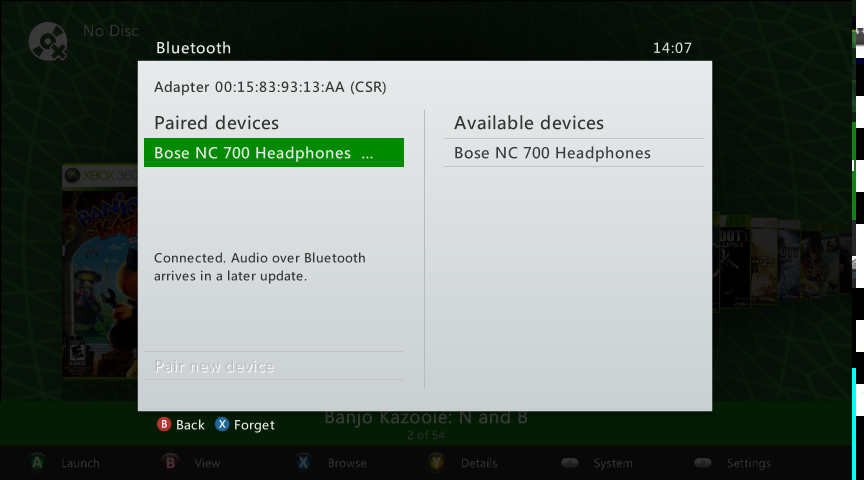

# Bluetooth stage 2: pairing and connecting

Status: implemented, awaiting hardware validation on COD.

## What it does

- Setup now also sends Write_Simple_Pairing_Mode(1) and Write_Local_Name
  ("Xbox 360"), and the event mask adds the Secure Simple Pairing events.
  Both commands are warnings if a controller rejects them.
- Selecting a device under **Available devices** pairs with it:
  Create_Connection → Authentication_Requested → (Link Key Request → negative
  reply) → IO Capability Request → reply NoInputNoOutput, dedicated bonding,
  no MITM → User Confirmation Request → accept ("Just Works") → Link Key
  Notification → Authentication Complete → Set_Connection_Encryption →
  Encryption Change. Headphones without SSP get legacy PIN `0000`.
- The new link key is saved in `usb_audio360.bt` next to `usb_audio360.ini`
  (one line per device: address, key as 32 hex digits, key type, name). The
  key itself is never logged. Up to three devices; the oldest is dropped.
- **Paired devices** lists them. Pressing one connects with the stored key
  (no pairing mode needed) or disconnects it. **X** on a focused paired device
  forgets it. If the headphones reject a stored key (reset or paired
  elsewhere), it is forgotten and the page asks to pair again.
- Only one link at a time; searching is disabled while a device is
  connecting or connected. Incoming connections are not accepted yet.

## Code

- `src/bt_link.{h,cpp}`: portable `bt::Link` (connection, pairing,
  encryption, disconnect, timeouts) and `bt::PairedStore` (file format).
  Tested by `tests/bt_link_test.cpp` (run by `tools/test_uac.sh`).
- `src/bluetooth.cpp`: once the scanner is done, events and commands go to
  `bt::Link`; Guide requests arrive through a one-slot mailbox.

## Not yet

ACL data is not read or written, so no L2CAP/AVDTP yet: the link is up but
carries no audio (stage 3). Some headphones drop an idle link after a while.
