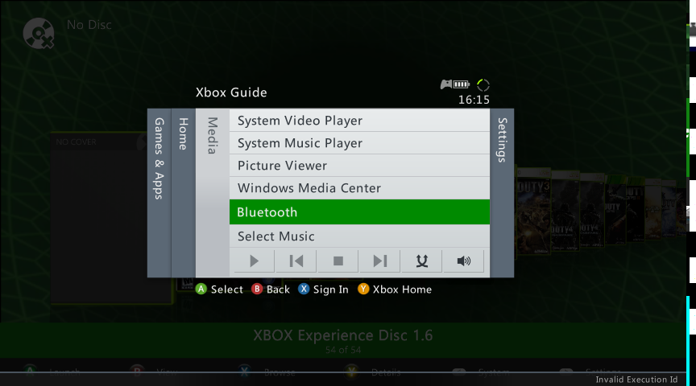
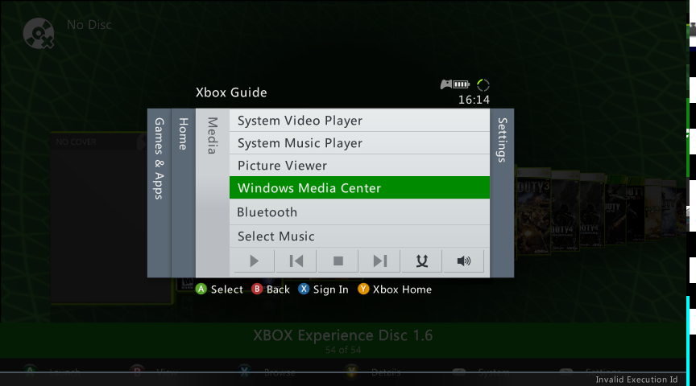
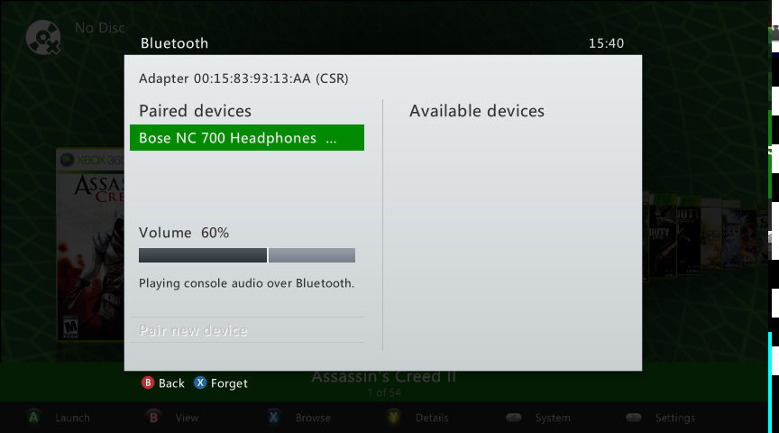

# Bluetooth stage 3: A2DP audio

Once a paired device is connected (authenticated and encrypted), the plugin
opens the A2DP stream and plays console audio over it.

The volume slider sets the plugin's own level. Swiping on the headphones
changes their absolute volume (AVRCP) and does not move the slider.

## Data path

- `ConfigTick` opens the adapter's bulk IN and bulk OUT endpoints right after
  the interrupt endpoint (`bt-acl open ...` in the log). The transport tracks
  at most three data endpoints, which is exactly event + ACL in + ACL out.
  If either open fails, scanning and pairing keep working without audio.
- Bulk IN: one transfer per USB packet (max packet size), so an ACL packet
  that ends on a packet boundary is never held back. Bytes go through a ring
  into `bt::AclAssembler`, then `bt::A2dpSource::OnFrame`.
- Bulk OUT: three slots. L2CAP frames from `A2dpSource` are split into HCI ACL
  packets of at most the controller's ACL MTU (`Read_Buffer_Size`), first
  fragment flagged 2, continuations 1.
- Flow control: credits start at the controller's ACL buffer count and come
  back with `Number_Of_Completed_Packets` (event 0x13), which `DrainEvents`
  intercepts before the link layer.

## Stream

- `A2dpSource::Start` runs as soon as the link reports connected: AVDTP
  signalling channel, DISCOVER, GET_CAPABILITIES, SET_CONFIGURATION (SBC
  48 kHz joint stereo, 16 blocks, 8 subbands, loudness, bitpool <= 53), OPEN,
  media channel, START.
- While streaming, packets are paced by `GetTickCount` 60 ms ahead of real
  time, as many SBC frames per packet as the remote media MTU and the
  controller buffers allow (max 15).
- The first 2 s are a 375 Hz test tone (one period per SBC frame). After that
  the plugin plays the captured system mix (`AudioReadBluetoothPcm`), which
  has the USB Audio volume and mute applied. A 1536-frame cushion (32 ms) is
  built before audio starts and the ring is trimmed back when it exceeds 3072.
  While a USB DAC owns the mix, Bluetooth gets silence.

## Diagnostics

`UsbBtA2dp[16]` (marker `UAAD`) over XBDM: 1 A2DP state, 2/3 bulk IN
completions/status, 4 L2CAP frames in, 5/6/7 bulk OUT submitted/completed/
status, 8 credits, 9 media packets, 10 silence-padded PCM frames, 11/12 bulk
open status, 13 SBC frames, 14/15 ACL MTU/buffers.

Log lines: `bt-acl ...`, `bt-a2dp <state>`, `bt-a2dp sbc ...`,
`bt-a2dp failed reason=... detail=...`.

## SDP

The first hardware run showed the Bose opening an SDP channel (PSM 1) to the
console right after our AVDTP channel came up, and ignoring AVDTP DISCOVER
once we refused it. `A2dpSource` now accepts SDP on local CID 0x0042 and
answers with `bt::SdpHandle` (src/bt_sdp.cpp): one A2DP Source record
(handle 0x00010001; AudioSource 0x110A, L2CAP PSM 0x19 + AVDTP 1.3, A2DP 1.3,
features Player), supporting ServiceSearch, ServiceAttribute and
ServiceSearchAttribute with continuation.

## AVRCP (headphone volume keys)

SDP also offers an AVRCP Target record (handle 0x00010002, category 1,
AVCTP PSM 0x17, AVRCP 1.4). `A2dpSource` accepts the headphones' AVCTP
channel on local CID 0x0043, or opens it itself 1.5 s after streaming starts
if they have not. `bt::AvrcpHandle` (src/bt_avrcp.cpp) answers UNIT/SUBUNIT
INFO, PASS THROUGH (accepted), GetCapabilities, GetPlayStatus and
RegisterNotification (playback status / track changed, interim only), and
rejects the rest. PASS THROUGH volume up/down/mute presses change the plugin
volume (`bt-avrcp key=...` in the log).

Absolute volume: an AVRCP Controller record (handle 0x00010003, category 2)
is offered too, and once AVCTP is configured the console registers for the
headphones' EVENT_VOLUME_CHANGED (re-registering after every CHANGED). The
headphones then render their own volume (touch swipes on the NC 700) and
report it (`bt-avrcp absolute volume=N/127`); the console volume is left as
is.

## Boot on a hub

An adapter behind an external hub at boot is enumerated and closed (no
driver) before DashLaunch loads the plugin; the root-port recovery
(`ReenumerateBootDevice`) cannot reach it, and the Usb0 stick may sit on the
same hub. `ReenumerateHubDevice` (driver.cpp) finds the single driverless
type-2 node whose parent uses the hub class driver (0x801721EC on 17559),
checks it with GetPortDeviceNode (export 881), and in the USB domain replays
the hub driver's connection-change pair for that port only:
DeviceDisconnected 0x800D6798, then DeviceConnected 0x800D7D20. Both routines
and the hub descriptor are signature-checked. Node +8: bits 0-1 controller,
2-4 port (0-based), 0x40 configured, 0x80 removal in progress.
Switch: USB_AUDIO360_BT_HUB_BOOT_RECOVERY.
